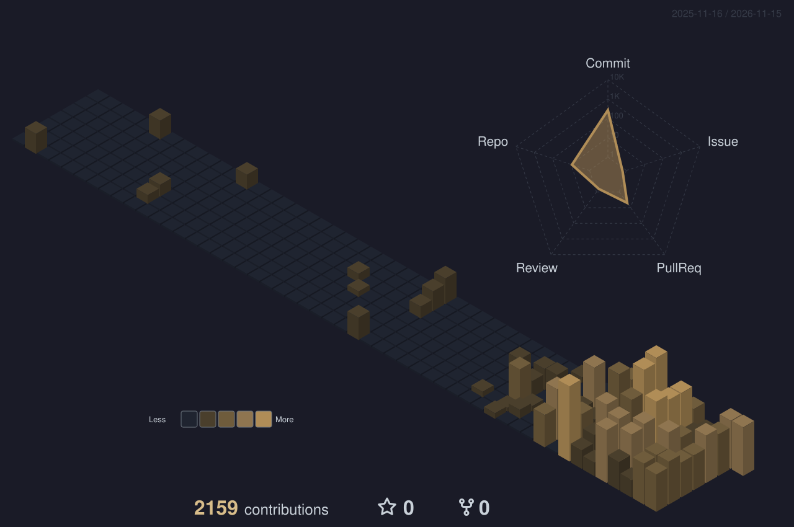

<!--
  ⛩️  RAI PRAMANA — ライ・プラマナ
  Neo-Tokyo theme: #1a1b27 ink · #F7C948 gold · #E60012 red · #c9d1d9 text
  Auto widgets: 3D contributions + contribution snake (GitHub Actions, daily)
-->

 

 

&nbsp;&nbsp;

&nbsp;&nbsp;

 

## 自己紹介 · About Me

- 🌸 **Name** — I Kadek Rai Pramana · call me **Rai**（ライ）
- 🗾 **Base** — Bali, Indonesia（WITA · UTC+8）
- 💻 **Focus** — software engineering · data engineering · machine learning · automation
- 🏗️ **Building** — [hermes-agent](https://github.com/rai-pramana/hermes-agent) · [bansos-router](https://github.com/rai-pramana/bansos-router)
- 🧭 **Motto** — 七転び八起き · *fall seven times, stand up eight*

## 技術スタック · Tech Stack

<strong>言語 · Languages</strong>

<strong>ウェブ · Web</strong>

<strong>ML・データ · ML &amp; Data</strong>

<strong>ツール · Tools</strong>

## プロジェクト · Featured Projects

| ⛩️ Project | 概要 · Description | Stack |
| :-- | :-- | :-- |
| [**Holic-Barbershop**](https://github.com/rai-pramana/Holic-Barbershop) | Antrean barbershop online — QR check-in, status real-time | `Laravel` `Blade` `MySQL` |
| [**NyankoGarage**](https://github.com/rai-pramana/NyankoGarage) | Manajemen bengkel — produk, stok, transaksi real-time | `Next.js` `NestJS` `TS` |
| [**NyankoMatch-CRM**](https://github.com/rai-pramana/NyankoMatch-CRM) | Platform CRM pelanggan | `Next.js` `NestJS` `PostgreSQL` |
| [**VehicleAccident-Detection-YOLO**](https://github.com/rai-pramana/VehicleAccident-Detection-YOLO) | Deteksi kecelakaan dari kamera + playground | `YOLO` `PyTorch` `Streamlit` |
| [**DC-Membangun-Sistem-Machine-Learning**](https://github.com/rai-pramana/DC-Membangun-Sistem-Machine-Learning) | Pipeline MLOps end-to-end | `Python` `MLflow` `Actions` |
| [**Data-Warehouse-Penyewaan-Kamera**](https://github.com/rai-pramana/Data-Warehouse-Penyewaan-Kamera) | Data warehouse & ETL penyewaan kamera | `MySQL` `SQL` |
| [**BookID**](https://github.com/Kampus-Merdeka-Software-Engineering/FE-2-Medan-14) · [server](https://github.com/Kampus-Merdeka-Software-Engineering/BE-2-Medan-14) | Booking hotel — capstone Kampus Merdeka | `JavaScript` `REST` |
| [**PCD-Image-Enhancement**](https://github.com/rai-pramana/PCD-Image-Enhancement) | Playground peningkatan kualitas citra · [demo](https://image-enhancement-pcd.netlify.app/) | `HTML` `JS` `Netlify` |

## 統計 · GitHub Stats

 

 

 

 

 

## 3D コントリビューション · 3D Contributions

毎日自動生成 · regenerated daily by GitHub Actions

## 蛇 · Snake

<picture>
  <source media="(prefers-color-scheme: dark)" srcset="https://raw.githubusercontent.com/rai-pramana/rai-pramana/output/snake-dark.svg" />
  <source media="(prefers-color-scheme: light)" srcset="https://raw.githubusercontent.com/rai-pramana/rai-pramana/output/snake.svg" />
  
</picture>

蛇がコントリビューションを食べます · the snake eats my contributions

## 連絡先 · Connect

&nbsp;&nbsp;

 

**一期一会** — *treasure every encounter*　·　よろしくお願いします！

