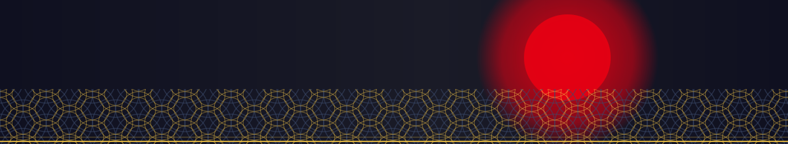
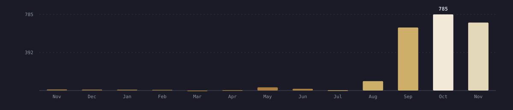
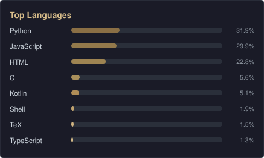

<!--
  ⛩️  RAI PRAMANA — ライ・プラマナ
  間 · ma — the space between. Restraint over ornament.

  DUAL THEME — every widget is wrapped in <picture>, so light-theme visitors get a
  white card instead of a dark navy slab on a white page. GitHub wraps these in
  <themed-picture> itself and swaps sources on theme toggle.

  PALETTE — one accent only: muted gold. No saturated red anywhere in the widgets.

  dark : ink #1a1b27 · soft gold #D8BD8A (titles) · muted gold #B08D57 (icons)
         text #c9d1d9 · border #353A47 · deep ink #141520 (hero vignette)
  light: white #ffffff · deep gold #87683A (titles + icons) · text #24292f
         text #24292f · border #DCDCDC

  Charts stay inside one warm family (hue 27-47 deg) instead of a rainbow:
  bronze -> gold -> cream on dark, near-black -> bronze on light. Every slice
  clears 3:1 against its card (WCAG 1.4.11) and neighbouring slices are kept
  apart by >= 0.10 OKLab dE, which is what a monotone ramp fails at.

  Why muted: #F7C948 and #E60012 read as toy-bright at 546px and fought the
  neo-Tokyo ink. Dropping them to #D8BD8A / #B08D57 keeps contrast (5.52:1 on
  ink, 5.16:1 on white) while letting the seigaiha texture and crest carry the theme instead of
  the colour shouting over it.

  Auto : 3D contributions + snake, regenerated daily by GitHub Actions.

  Editing notes (learned the hard way):
  · every block sits in its own 
: inside a 
, blank lines do NOT create
    paragraphs and GitHub strips style=, so widgets collapse to ~5px gaps
  · no <text> in any local SVG: every glyph is an outlined <path> (tools/jp.py).
    GitHub renders  on the *viewer's* machine, so any <text> is
    one missing font away from a row of boxes
  · NEVER point at a third-party widget that renders Japanese. shields.io,
    komarev and readme-typing-svg all emit <text> bound to Verdana/Geneva/DejaVu
    (or a webfont they never embed -- readme-typing-svg asked for Zen Maru Gothic
    with @font-face count 0, base64 count 0, then fell through to monospace).
    Those fonts ship everywhere and contain zero CJK glyphs, so the boxes appear
    on every platform, Windows included. Their labels are ASCII for that reason;
    the Japanese lives in our own outlined SVGs and in the HTML headings.
    Corollary: the charts may use <text> freely, but only for ASCII (month
    initials, axis ticks, language names) set in a monospace stack.
  · paired cards need align="top": ghstats with show= renders 213px tall at
    width 345 (verified live), streak 195px, so they bottom-align otherwise
  · ghstats `show=reviews,prs_merged,prs_merged_percentage` is undocumented but
    live -- it adds PR/Review rows the default card omits. In srcset the commas
    MUST be %2C: a literal comma splits srcset candidates, truncates the URL at
    `show=reviews`, and silently ships the 13-row card. Only ASCII-safe
    additions: stars/commits/PRs. Never add discussions, they render 0.
  · repo descriptions must stay ASCII: an em-dash shows up as a literal backslash-u2014
  · never bulk-replace  tags — rewrite the file and assert src+alt on each
  · snake light file is output/snake.svg (NOT snake-light.svg)
  · chart alt text carries the numbers: a chart is an image, so the values it
    encodes must be readable without seeing it. Keep the totals in the README in
    step with the data, or the alt becomes a lie.

  Regenerate the drawn assets after editing them:
    ~/.hermes/cache/scratch/.fontvenv/bin/python tools/build_art.py       # typing band
    python3 tools/build_langs.py                                          # language donut
    python3 tools/fetch_contrib.py && python3 tools/build_momentum.py     # activity chart
  Each exits non-zero if any colour drops below its contrast floor, or if two
  neighbouring donut slices are too alike (OKLab dE < 0.10).
-->

<picture>
  <source media="(prefers-color-scheme: dark)" srcset="https://raw.githubusercontent.com/rai-pramana/rai-pramana/main/assets/hero-dark.svg?v=5" />
  <source media="(prefers-color-scheme: light)" srcset="https://raw.githubusercontent.com/rai-pramana/rai-pramana/main/assets/hero-light.svg?v=5" />
  
</picture>

<a href="https://github.com/rai-pramana"><picture>
  <source media="(prefers-color-scheme: dark)" srcset="https://raw.githubusercontent.com/rai-pramana/rai-pramana/main/assets/typing-dark.svg?v=4" />
  <source media="(prefers-color-scheme: light)" srcset="https://raw.githubusercontent.com/rai-pramana/rai-pramana/main/assets/typing-light.svg?v=4" />
  
</picture></a>

&nbsp;

&nbsp;

&nbsp;

## 技術 · Stack

&nbsp;&nbsp;&nbsp;&nbsp;&nbsp;&nbsp;&nbsp;

&nbsp;&nbsp;&nbsp;&nbsp;&nbsp;&nbsp;

&nbsp;&nbsp;&nbsp;&nbsp;&nbsp;&nbsp;&nbsp;&nbsp;

## 勢い · Momentum

<picture>
  <source media="(prefers-color-scheme: dark)" srcset="https://raw.githubusercontent.com/rai-pramana/rai-pramana/main/assets/momentum-dark.svg?v=17" />
  <source media="(prefers-color-scheme: light)" srcset="https://raw.githubusercontent.com/rai-pramana/rai-pramana/main/assets/momentum-light.svg?v=17" />
  
</picture>

## 記録 · Stats

<picture>
  <source media="(prefers-color-scheme: dark)" srcset="https://gh-readme-stats.vercel.app/api?username=rai-pramana&show_icons=true&include_all_commits=true&count_private=true&rank_icon=github&show=reviews%2Cprs_merged%2Cprs_merged_percentage&card_width=345&bg_color=1a1b27&title_color=D8BD8A&text_color=c9d1d9&icon_color=B08D57&hide_border=true" />
  <source media="(prefers-color-scheme: light)" srcset="https://gh-readme-stats.vercel.app/api?username=rai-pramana&show_icons=true&include_all_commits=true&count_private=true&rank_icon=github&show=reviews%2Cprs_merged%2Cprs_merged_percentage&card_width=345&bg_color=ffffff&title_color=87683A&text_color=24292f&icon_color=87683A&hide_border=true" />
  
</picture>&nbsp;<picture>
  <source media="(prefers-color-scheme: dark)" srcset="https://streak-stats.demolab.com?user=rai-pramana&background=1a1b27&border=353A47&stroke=B08D57&ring=D8BD8A&fire=B08D57&currStreakNum=D8BD8A&currStreakLabel=D8BD8A&sideNums=c9d1d9&sideLabels=c9d1d9&dates=8b949e&hide_border=true&card_width=345" />
  <source media="(prefers-color-scheme: light)" srcset="https://streak-stats.demolab.com?user=rai-pramana&background=ffffff&border=DCDCDC&stroke=87683A&ring=87683A&fire=87683A&currStreakNum=87683A&currStreakLabel=87683A&sideNums=24292f&sideLabels=24292f&dates=6e7781&hide_border=true&card_width=345" />
  
</picture>

<picture>
  <source media="(prefers-color-scheme: dark)" srcset="https://raw.githubusercontent.com/rai-pramana/rai-pramana/main/assets/langs-dark.svg?v=2" />
  <source media="(prefers-color-scheme: light)" srcset="https://raw.githubusercontent.com/rai-pramana/rai-pramana/main/assets/langs-light.svg?v=2" />
  
</picture>

<picture>
  <source media="(prefers-color-scheme: dark)" srcset="https://activitygraph.vercel.app/graph?username=rai-pramana&bg_color=1a1b27&color=D8BD8A&line=B08D57&point=D8BD8A&area=true&area_color=D8BD8A&hide_border=true" />
  <source media="(prefers-color-scheme: light)" srcset="https://activitygraph.vercel.app/graph?username=rai-pramana&bg_color=ffffff&color=87683A&line=87683A&point=87683A&area=true&area_color=87683A&hide_border=true" />
  
</picture>

## 3D 貢献 · Contributions

<picture>
  <source media="(prefers-color-scheme: dark)" srcset="https://raw.githubusercontent.com/rai-pramana/rai-pramana/main/profile-3d-contrib/profile-custom.svg" />
  <source media="(prefers-color-scheme: light)" srcset="https://raw.githubusercontent.com/rai-pramana/rai-pramana/main/profile-3d-contrib/profile-custom-light.svg" />
  
</picture>

## 蛇 · Snake

<picture>
  <source media="(prefers-color-scheme: dark)" srcset="https://raw.githubusercontent.com/rai-pramana/rai-pramana/output/snake-dark.svg" />
  <source media="(prefers-color-scheme: light)" srcset="https://raw.githubusercontent.com/rai-pramana/rai-pramana/output/snake.svg" />
  
</picture>

一期一会 · よろしくお願いします

<picture>
  <source media="(prefers-color-scheme: dark)" srcset="https://raw.githubusercontent.com/rai-pramana/rai-pramana/main/assets/seigaiha-dark.svg?v=3" />
  <source media="(prefers-color-scheme: light)" srcset="https://raw.githubusercontent.com/rai-pramana/rai-pramana/main/assets/seigaiha-light.svg?v=3" />
  
</picture>

